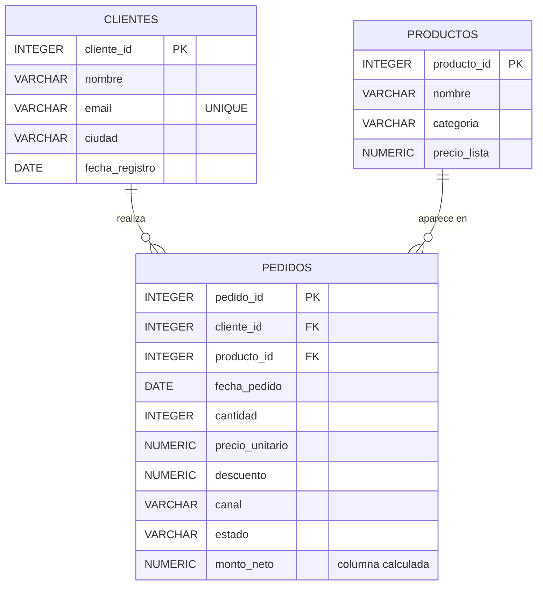

# ☕ Grano de Origen · Análisis Exploratorio de Ventas en PostgreSQL

> **Proyecto Capstone** · Curso de SQL · Análisis de Datos con PostgreSQL
> Autora: **María Alejandra Naranjo Palacio**


---

## 📌 Resumen ejecutivo

**Grano de Origen** es una tienda online de café de especialidad colombiano. En 2025 vendió **$21,9 millones COP** en 283 pedidos entregados. Este análisis encontró tres cosas que el equipo directivo debería atender:

1. **El negocio depende de pocos clientes.** 6 clientes (el 24 %) generan el **57 % de las ventas**. Perder a uno solo de los 5 principales significaría perder entre el 8 % y el 13 % de los ingresos.
2. **Instagram trae volumen, pero pierde ventas.** Pasó de 6 a 72 pedidos entregados entre el primer y el segundo semestre, pero **1 de cada 4 pedidos por Instagram se cancela** (25,7 % frente a 4,4 % en la web). Eso son **$2,1 millones perdidos** en el año.
3. **El cuarto trimestre es la temporada clave.** Octubre a diciembre concentra el **36 % de las ventas del año**, y diciembre por sí solo vende 6 veces lo que vende febrero.

---

## 1. 🎯 Problema de negocio

La gerencia necesita decidir **dónde invertir el presupuesto de 2026** (fidelización, publicidad, inventario y catálogo). Para eso, este análisis responde siete preguntas:

| # | Pregunta de negocio | Para qué decisión sirve |
|---|---|---|
| P1 | ¿Quiénes son los 5 clientes que más gastan y cuánto dependemos de ellos? | Programa de lealtad y riesgo de concentración |
| P2 | ¿Cómo se comportan las ventas mes a mes? | Planeación de inventario y pauta por temporada |
| P3 | ¿Cuáles son los 3 productos menos vendidos? | Depuración del catálogo y promociones |
| P4 | ¿Cuáles son los pedidos más grandes de cada categoría? | Detectar compras de alto valor por línea |
| P5 | ¿Cuál es el perfil del cliente leal y cuánto pesa cada segmento? | Estrategia de retención |
| P6 | ¿En qué canal perdemos más ventas? | Optimizar el embudo de pago |
| P7 | ¿Dónde está concentrada la demanda? | Logística y pauta geográfica |

> ✅ Se resuelven **los 4 puntos** exigidos por la consigna (P1 a P4) y 3 preguntas adicionales (P5 a P7).

---

## 2. 🗂️ Estructura del repositorio

```
capstone-postgresql/
├── estructura.sql   → Crea las tablas, carga los datos crudos y los limpia
├── analisis.sql     → 7 preguntas de negocio resueltas y comentadas
└── README.md        → Este documento
```

---

## 3. 🧱 Modelo de datos

El dataset fue construido para el proyecto (opción "creá vos mismo 3 tablas"). Simula un año real de operación **con errores típicos de captura** para poder practicar la limpieza.



| Tabla | Filas (limpias) | Contenido |
|---|---|---|
| `clientes` | 25 | Clientes de 8 ciudades de Colombia |
| `productos` | 15 | 6 categorías: café en grano, molido, cápsulas, accesorios, kits y suscripciones |
| `pedidos` | 320 | Pedidos de enero a diciembre de 2025 (283 entregados, 37 cancelados) |

**Decisiones de tipos de datos**

- **`NUMERIC(12,2)` para dinero**, nunca `FLOAT`: es exacto y no genera errores de redondeo en las sumas de ventas.
- **`DATE` para fechas**: permite agrupar por mes (`DATE_TRUNC`) y por trimestre (`EXTRACT`).
- **Restricciones `CHECK`**: la base de datos rechaza valores imposibles (cantidad 0, descuento mayor al 100 %).
- **`monto_neto` es una columna calculada** (`GENERATED ALWAYS AS ... STORED`): la fórmula del ingreso vive en un solo lugar, así ninguna consulta la escribe mal.
- **Índices solo en las llaves foráneas y en la fecha**, que son las columnas usadas en `JOIN` y filtros.

---

## 4. 🧹 Limpieza de datos

Los datos llegan primero a tablas **staging** (`stg_*`) con todas las columnas en texto, tal como vendrían de un CSV. Después se transforman hacia las tablas definitivas. Cada decisión está documentada en `estructura.sql`.

| Problema encontrado | Casos | Decisión tomada | Por qué |
|---|---|---|---|
| Precio unitario vacío (columna crítica) | 18 | `COALESCE(precio_unitario, precio_lista)` | Es el precio que el cliente pagaría; poner 0 hundiría las ventas |
| Producto sin precio de lista | 2 | `COALESCE` con la **mediana** del precio cobrado | La mediana no se deja arrastrar por precios atípicos |
| Cantidad vacía | 7 | `COALESCE(cantidad, 1)` | Si el pedido existe, se vendió al menos 1 unidad (opción conservadora) |
| Descuento vacío | 167 | `COALESCE(descuento, 0)` | Sin esto, `monto_neto` sería `NULL` y el pedido "valdría" cero |
| Canal vacío | 12 | `COALESCE(..., 'Sin dato')` | No se pierden del análisis y se ve el tamaño del problema |
| Ciudad vacía o `''` | 3 | `COALESCE(NULLIF(TRIM(ciudad), ''), 'Sin dato')` | `NULLIF` convierte el texto vacío en `NULL` para que `COALESCE` lo atrape |
| Fechas en 2 formatos (`2025-03-14` y `14/03/2025`) | ~30 % | `CASE` + expresión regular + `TO_DATE` | Cada formato se convierte con su propia máscara |
| Categorías escritas distinto ("café en grano", "CAFÉ EN GRANO ") | 4 variantes | `CASE` sobre texto normalizado | Evita que una categoría aparezca partida en varias |
| Mayúsculas y espacios en nombres, emails, canal y estado | varios | `TRIM`, `INITCAP`, `LOWER` | Datos consistentes y emails comparables |
| Registros duplicados | 2 clientes · 3 pedidos | `DISTINCT ON (id)` | Un pedido duplicado se sumaría dos veces en las ventas |

**Verificación:** la consulta P0 de `analisis.sql` confirma que las columnas críticas quedaron con **0 nulos** y que los `JOIN` no duplican filas (320 pedidos antes y después de unir las tres tablas).

---

## 5. 🔍 Hallazgos principales

> Las cifras se expresan en pesos colombianos (COP). Solo se cuentan pedidos **entregados**.

### P1 · Top 5 clientes: alta concentración de ingresos

| Cliente | Ciudad | Pedidos | Gasto total | % de ventas |
|---|---|---:|---:|---:|
| David Zuluaga | Armenia | 34 | $2.860.300 | 13,1 % |
| Isabella Duque | Bogotá | 26 | $2.278.450 | 10,4 % |
| Juan Pablo Marín | Armenia | 36 | $2.210.450 | 10,1 % |
| Natalia Giraldo | Armenia | 31 | $2.099.900 | 9,6 % |
| Camila Ospina | Manizales | 26 | $1.665.600 | 7,6 % |

**¿Qué significa?** Solo 5 de 25 clientes generan **más de la mitad de las ventas (50,8 %)**. Es una fortaleza (son clientes muy fieles) y también un riesgo: si uno se va, el impacto es inmediato. Además, Juan Pablo es quien más compra (36 pedidos), pero su ticket promedio ($61.401) es menor que el de Isabella ($87.633). Son dos perfiles distintos: uno compra seguido y en pequeño, la otra compra menos veces pero productos de mayor valor.

### P2 · Ventas por mes: la temporada fuerte es el cierre del año

| Trimestre | Ventas | % del año |
|---|---:|---:|
| T1 | $3.866.450 | 17,6 % |
| T2 | $5.698.600 | 26,0 % |
| T3 | $4.481.950 | 20,5 % |
| **T4** | **$7.863.950** | **35,9 %** |

**¿Qué significa?** **Diciembre es el mejor mes ($4,03 M, 18 % del año)** y **febrero el más débil ($0,66 M)**. Octubre también es alto (+91 % frente a septiembre). Noviembre cae 44 %: parece un "valle" entre la campaña de octubre y la Navidad, y es una oportunidad para activar preventas de regalos. El tercer trimestre baja de forma sostenida (julio a septiembre caen entre 12 % y 14 % cada mes).

### P3 · Los 3 productos menos vendidos son todos accesorios

| Producto | Precio | Unidades vendidas en el año |
|---|---:|---:|
| Taza Esmaltada Artesanal | $38.000 | **0** |
| Filtro V60 Cerámico | $115.000 | 1 |
| Molino Manual de Acero | $165.000 | 2 |

**¿Qué significa?** La taza **no se vendió ni una vez en el año** (solo aparece gracias al `LEFT JOIN`; con un `JOIN` normal habría sido invisible). Los accesorios caros casi no rotan como producto individual. Toda la categoría Accesorios aporta solo el 7,9 % de los ingresos.

### P4 · Ranking de pedidos por categoría

- **Café en grano es el corazón del negocio: 40,3 % de los ingresos**, casi tres veces la segunda categoría.
- Los pedidos individuales más grandes del año están en **Suscripciones** ($432.000) y **Kits y regalos** ($392.000). Son compras de 3 o 4 unidades, típicas de regalos o compras para oficinas.
- El ranking con `RANK()` muestra empates reales: en Kits y regalos, tres pedidos comparten el 2.º puesto con $294.000, y dos de ellos son del mismo cliente (David Zuluaga).

### P5 · El perfil del cliente leal

| Segmento | Clientes | % clientes | % ventas | Gasto promedio |
|---|---:|---:|---:|---:|
| Leal (15+ pedidos) | 6 | 24 % | **56,9 %** | $2.078.658 |
| Recurrente (8 a 14) | 4 | 16 % | 15,9 % | $870.813 |
| Ocasional (menos de 8) | 15 | 60 % | 27,2 % | $397.050 |

**¿Qué significa?** Un cliente leal vale **5 veces más** que uno ocasional. Al revisar quiénes son los 6 leales aparece un perfil claro:

- **5 de 6 viven en el Eje Cafetero** (Armenia, Manizales y Pereira).
- **Compran sobre todo café en grano** (43 % de su gasto) y lo hacen principalmente por la **web** (49 %).
- **Casi no usan la suscripción** (apenas 1,8 % de su gasto), aunque compran más de una vez al mes. Es decir, ya se comportan como suscriptores, pero sin estar suscritos: es la oportunidad más clara para asegurar su recompra.

### P6 · Dónde perdemos ventas: el canal Instagram

| Canal | Pedidos | Tasa de cancelación | Ventas perdidas | Entregados 1.er sem → 2.º sem |
|---|---:|---:|---:|---|
| **Instagram** | 105 | **25,7 %** | **$2.127.950** | 6 → 72 |
| WhatsApp | 66 | 6,1 % | $383.000 | 39 → 23 |
| Web | 137 | 4,4 % | $430.700 | 61 → 70 |

**¿Qué significa?** Instagram es el canal que más crece, pero cancela **casi 6 veces más que la web**. Las ventas perdidas solo en Instagram ($2,1 M) superan lo que vende la tienda en un mes promedio ($1,8 M). El problema no es atraer clientes, sino **cerrar el pago**. Además, WhatsApp perdió volumen en el segundo semestre: parte de esos clientes parece haberse movido a Instagram, donde la conversión es peor.

### P7 · Demanda por ciudad

**Armenia concentra el 38 % de las ventas** ($8,3 M) con solo 5 clientes. Pereira tiene el ticket promedio más alto entre las ciudades grandes ($89.730). Hay 3 clientes con ciudad "Sin dato" que suman $1,26 M: un problema de captura que vale la pena corregir en el formulario de registro.

---

## 6. 💡 Recomendaciones para la dirección

| Prioridad | Recomendación | Basada en |
|---|---|---|
| 🔴 Alta | **Revisar el flujo de pago de Instagram** (link de pago directo, recordatorio por WhatsApp a las 24 h). Recuperar la mitad de lo cancelado sería ~$1 M al año. | P6 |
| 🔴 Alta | **Ofrecer la suscripción a los 6 clientes leales** (ya compran más de una vez al mes) con un beneficio de entrada, y crear una ruta para convertir "recurrentes" en "leales". | P1 · P5 |
| 🟡 Media | **Preparar inventario y pauta para octubre y diciembre**, y lanzar una **preventa navideña en noviembre** para llenar el valle. | P2 |
| 🟡 Media | **Pasar los accesorios a combos** (ej.: café en grano + molino manual) en lugar de venderlos solos, y retirar la taza del catálogo o incluirla como regalo. | P3 · P4 |
| 🟢 Baja | **Hacer obligatoria la ciudad** en el registro y el canal en cada pedido. | Limpieza · P7 |

---

## 7. ▶️ Cómo ejecutar el proyecto

**Requisitos:** PostgreSQL 13 o superior y pgAdmin 4 (o la consola `psql`).

### Opción A · pgAdmin (paso a paso)

1. Abrí pgAdmin y conectate a tu servidor.
2. Clic derecho en **Databases → Create → Database…** y escribí el nombre `capstone_project`. Guardá.
3. Seleccioná la base `capstone_project` y abrí **Tools → Query Tool**.
4. Abrí el archivo `estructura.sql` (ícono de carpeta), y ejecutalo completo con **F5**. Al final verás una tabla de verificación: `clientes 27 → 25`, `productos 15 → 15`, `pedidos 323 → 320`.
5. Abrí `analisis.sql`. Seleccioná una consulta (desde su comentario hasta el `;`) y ejecutala con **F5** para ver cada resultado por separado.
6. *(Opcional)* Clic derecho en la base → **ERD For Database** para ver el diagrama de tablas.

### Opción B · Consola `psql`

```bash
psql -U postgres -c "CREATE DATABASE capstone_project;"
psql -U postgres -d capstone_project -f estructura.sql
psql -U postgres -d capstone_project -f analisis.sql
```

> `estructura.sql` se puede ejecutar varias veces: al inicio borra y vuelve a crear todas las tablas.

---

## 8. 🛠️ Técnicas SQL aplicadas

| Técnica | Dónde se usa |
|---|---|
| `JOIN` y `LEFT JOIN` entre 3 tablas | P0, P1, P3, P4, P5, P7 |
| `GROUP BY` con `SUM`, `COUNT`, `AVG` | Todas las preguntas |
| Funciones de ventana: `RANK()`, `LAG()`, `SUM() OVER()` | P1, P2, P4, P5 |
| `CASE` (limpieza, segmentación y conteos condicionales) | estructura.sql, P5, P6 |
| `COALESCE` y `NULLIF` | estructura.sql, P3 |
| CTE (`WITH`) | estructura.sql, P1, P2, P4, P5 |
| Funciones de fecha: `DATE_TRUNC`, `TO_CHAR`, `EXTRACT`, `TO_DATE` | estructura.sql, P2, P6 |
| `DISTINCT ON`, `PERCENTILE_CONT`, `FILTER`, expresiones regulares | estructura.sql, P0 |
| Columna calculada `GENERATED ALWAYS AS`, `CHECK`, `UNIQUE`, índices | estructura.sql |

---

## 9. ⚠️ Limitaciones

- El dataset es **simulado** con fines académicos. Las cifras ilustran el método de análisis, no una empresa real.
- Cada pedido contiene un solo producto. En un caso real habría una tabla de detalle (`detalle_pedido`) para analizar qué productos se compran juntos.
- Con 25 clientes, algunas cifras por ciudad dependen de muy pocas personas (por ejemplo, Calarcá tiene un solo cliente). Antes de decidir por ciudad, convendría tener más datos.
